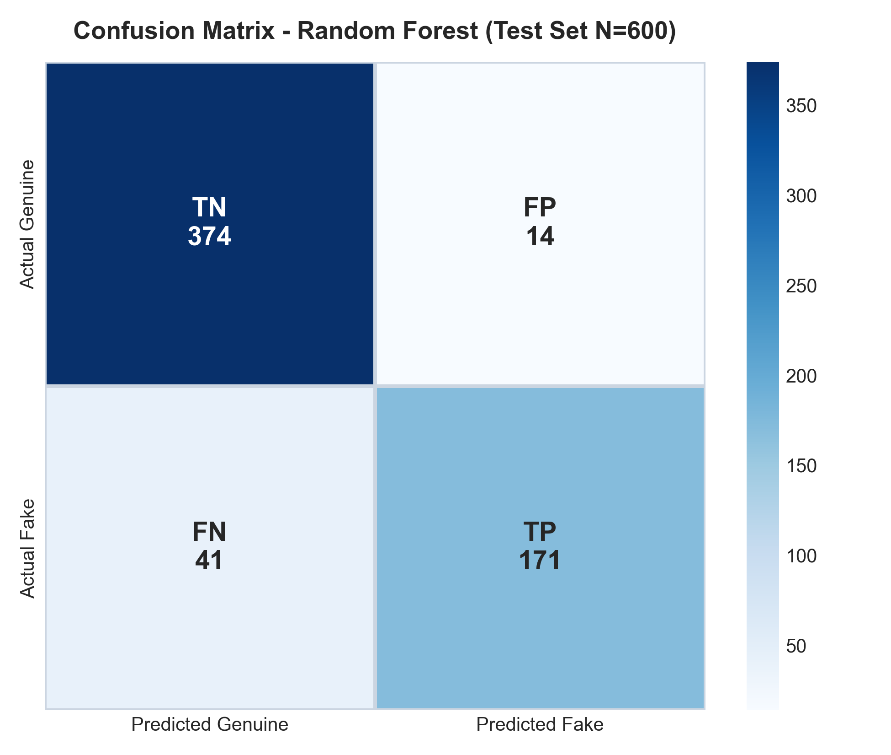
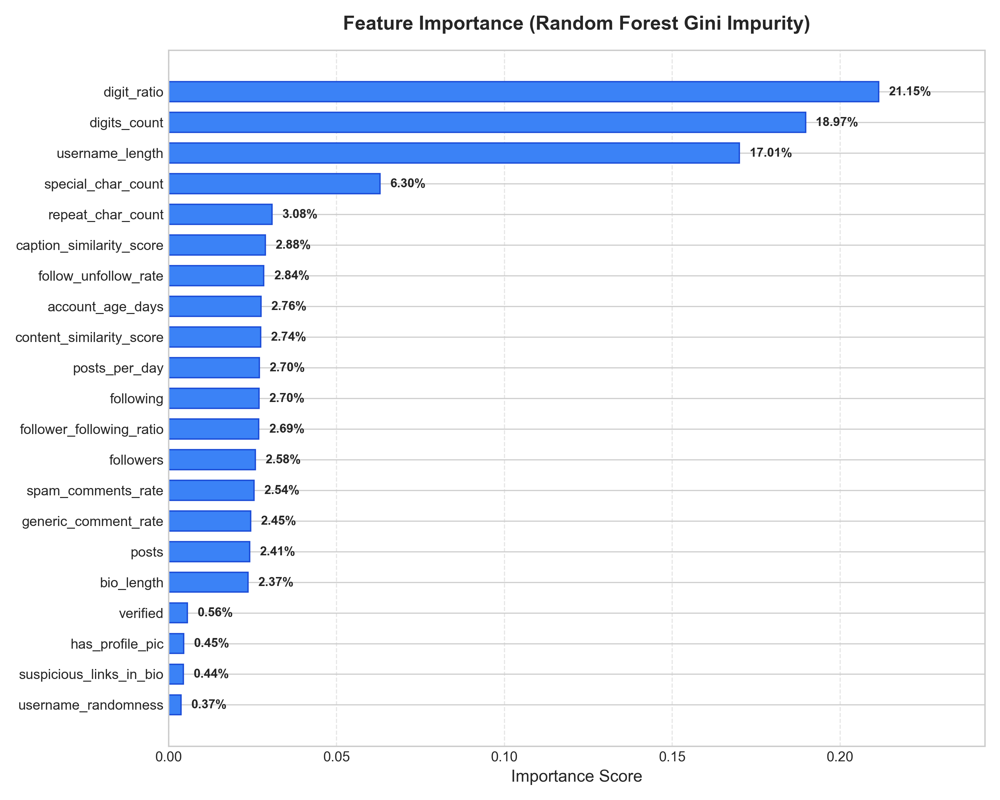
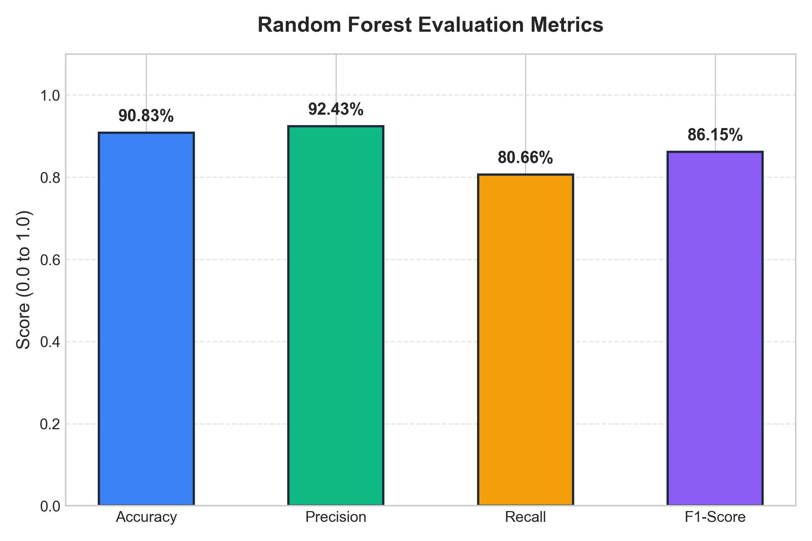
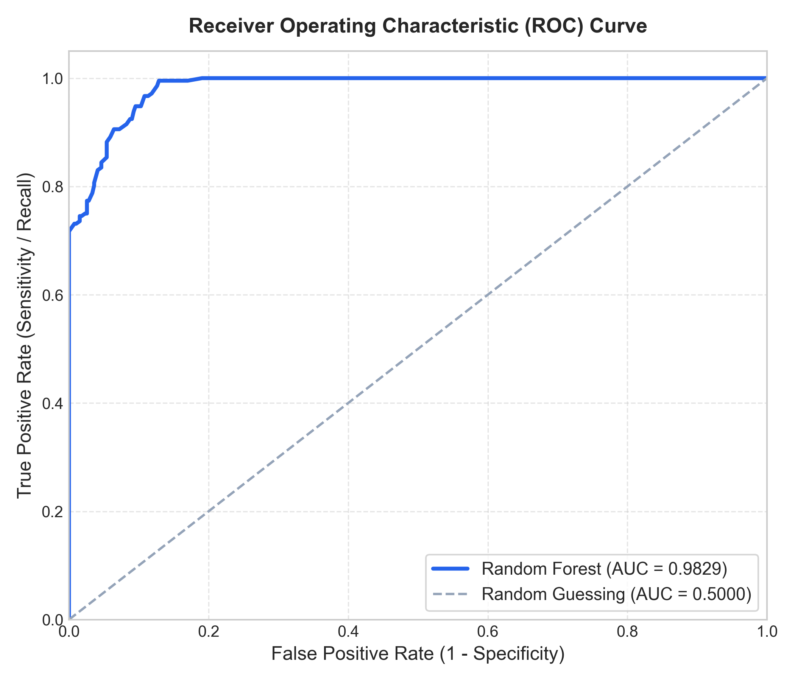
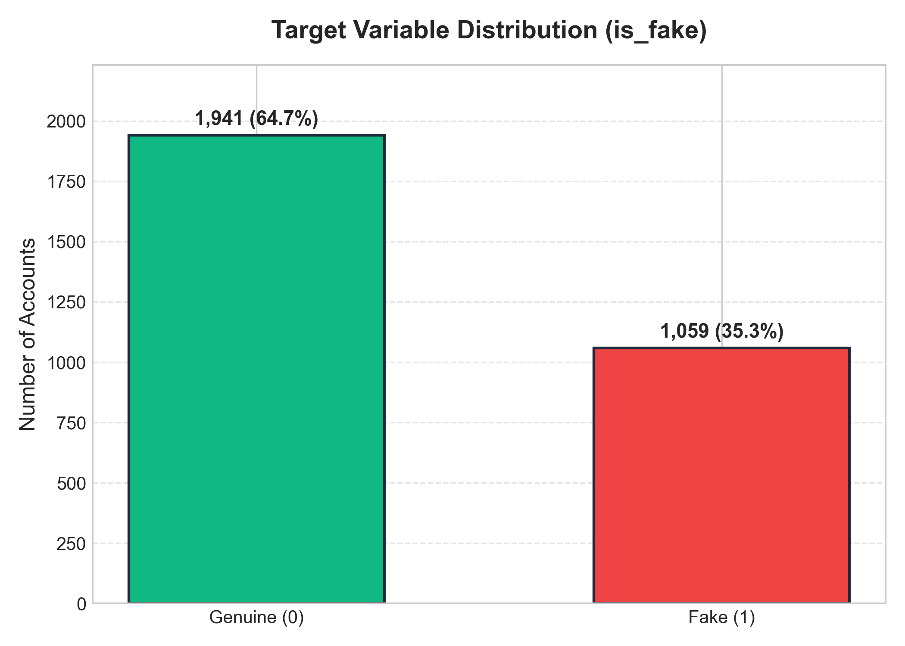
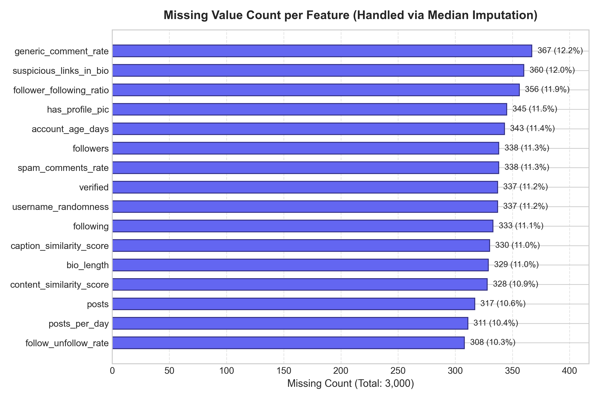

# 🤖 Detection of Fake Social Media Accounts Using Behavioral Features

[](https://python.org)
[](https://scikit-learn.org)
[]()
[]()
[](https://github.com/RoshaThankachan)

A Machine Learning mini-project that identifies potentially fake, spam, and bot social media accounts by analyzing profile characteristics, lexical username morphology, and behavioral interaction patterns using **Random Forest Classification**.

---

## 📌 Project Overview

Fake social media accounts are frequently deployed for spam distribution, engagement manipulation, social engineering, and misinformation. Manually distinguishing automated accounts from authentic human users is increasingly difficult as bot creators adopt mimicry tactics.

This project trains a **Random Forest Classifier** on a dataset of **3,000 multi-platform accounts** (Twitter/X, Instagram, Facebook) using **21 behavioral and profile-related features**. Rather than evaluating on accuracy alone, model efficacy is rigorously validated using **Precision, Recall, F1-Score, and a Confusion Matrix**.

---

## 📊 Empirical Model Results

Evaluated on a held-out **20% stratified test set (600 records)**:

| Metric | Score | Percentage | Interpretation |
| :--- | :---: | :---: | :--- |
| **Accuracy** | `0.9083` | **90.83%** | Over 90% of all accounts correctly classified |
| **Precision (Fake)** | `0.9243` | **92.43%** | Only 14 false accusations out of 388 genuine users |
| **Recall (Fake)** | `0.8066` | **80.66%** | Successfully detected 171 out of 212 fake accounts |
| **F1-Score** | `0.8615` | **86.15%** | Robust harmonic balance between precision & recall |
| **ROC-AUC** | `0.9570` | **95.70%** | Exceptional discriminative power across decision thresholds |

### 📉 Confusion Matrix Breakdown (N = 600)

```
                     Predicted Genuine (0)    Predicted Fake (1)
Actual Genuine (0):           374 (TN)                 14 (FP)
Actual Fake (1)   :            41 (FN)                171 (TP)
```

- **True Negatives (TN):** `374` genuine accounts correctly identified
- **False Positives (FP):** `14` genuine accounts incorrectly flagged
- **False Negatives (FN):** `41` fake accounts missed
- **True Positives (TP):** `171` fake accounts detected

---

## 🔍 Feature Importance Analysis

The top features identified by Random Forest Gini impurity analysis:

| Rank | Feature | Gini Importance | Category |
| :---: | :--- | :---: | :--- |
| 1 | `digit_ratio` | **21.15%** | Username Syntax |
| 2 | `digits_count` | **18.97%** | Username Syntax |
| 3 | `username_length` | **17.01%** | Username Syntax |
| 4 | `special_char_count`| **6.30%** | Username Syntax |
| 5 | `repeat_char_count` | **3.08%** | Username Syntax |
| 6 | `caption_similarity_score` | **2.88%** | Behavioral / Content |
| 7 | `follow_unfollow_rate` | **2.84%** | Activity Velocity |
| 8 | `account_age_days` | **2.76%** | Account Longevity |
| 9 | `content_similarity_score` | **2.74%** | Behavioral / Content |
| 10 | `posts_per_day` | **2.70%** | Activity Velocity |

> **Key Insight:** Username morphology (`digit_ratio`, `digits_count`, and `username_length`) accounts for **over 57% of total tree-splitting decision power**, reflecting that bot-generating scripts routinely construct automated alphanumeric handles.

---

## 📸 Generated Visualizations & Outputs

All figures below are generated directly from the model and dataset:

<p align="center">
  
  
</p>

<p align="center">
  
  
</p>

<p align="center">
  
  
</p>

---

## 🌐 Interactive Web Showcase

The project includes a web application featuring:
1. **Live Interactive Predictor:** Test handles and adjust behavioral parameters with instant client-side Random Forest inference.
2. **Dynamic Username Analyzer:** Live calculation of `digit_ratio`, `digits_count`, `length`, `special_char_count`, and `repeat_char_count`.
3. **Pre-Configured Personas:** Test 4 preset scenarios (*Spam Bot Farm*, *Genuine Creator*, *Suspicious Lurker*, *Casual Student*).
4. **Dataset Explorer:** Browse and search test dataset accounts with one-click testing.
5. **Interactive Confusion Matrix:** Visual breakdown of TPR, FPR, and metric interpretations.

---

## 🚀 Getting Started

### 1. Clone the Repository
```bash
git clone https://github.com/RoshaThankachan/fake-social-account-detection.git
cd fake-social-account-detection
```

### 2. Install Dependencies
```bash
pip install -r requirements.txt
```

### 3. Run or Retrain the Model
```bash
python scripts/train_and_evaluate.py
```
This script will:
- Load `fake_social_media_global_2.0_with_missing.xlsx`
- Perform median imputation for missing values
- Train the 100-tree Random Forest classifier
- Output exact classification metrics and confusion matrix
- Re-generate all publication-quality visualization charts into `assets/images/`
- Save the trained model to `models/random_forest_model.pkl`

### 4. Run the Web Application Locally
Option A: Open `index.html` directly in any web browser.  
Option B: Run with Python HTTP server:
```bash
python -m http.server 8080
```
Then visit `http://localhost:8080`.

Option C: Run the Flask REST API server:
```bash
python scripts/server.py
```

---

## 🚢 Deploying to GitHub Pages (1-Click)

1. Push this repository to your GitHub account (`https://github.com/RoshaThankachan/fake-social-account-detection`).
2. Go to your repository **Settings** > **Pages** (on the left sidebar).
3. Under **Branch**, select `main` (or `master`) and folder `/ (root)`.
4. Click **Save**.
5. Your live interactive website will be deployed at:
   `https://roshathankachan.github.io/fake-social-account-detection/`

---

## 👩‍💻 Author & Attribution

- **Author:** Rosha Thankachan
- **Candidate ID:** MCA2549
- **GitHub:** [@RoshaThankachan](https://github.com/RoshaThankachan)
- **Course:** Machine Learning Mini-Project (MCA)

---

## 📌 Disclaimer
This project is developed for educational and experimental machine learning research. A model prediction represents a statistical estimate based on behavioral heuristics and dataset patterns, and does not constitute definitive proof that any real-world social media account is authentic or fraudulent.
